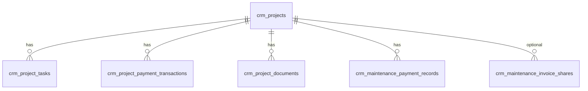

# Supabase CRM database

Automate CRM data currently lives in `data/*.json`. This folder defines the **Postgres schema** and **one-shot migration** to Supabase.

## Does `supabase/migrations/` alone create everything?

**Partially — read this carefully:**

| Step | What it does |
|------|----------------|
| Run **`20260320120000_initial_crm_schema.sql`** | Creates **empty** CRM tables, enums, indexes, triggers, RLS, and one default maintenance settings row. **No project/finance data.** |
| Run **`npm run migrate:supabase`** (repo root) | **Imports** your existing JSON from `data/` into those tables. |
| Restart dev server with Supabase env vars | Next.js API **reads/writes Supabase** by default (`lib/crm-*-store.ts`). Set **`CRM_DATA_BACKEND=json`** only to use local JSON again. |

The migrations folder is **not executed automatically** by Next.js. You must apply SQL in the Supabase Dashboard (SQL Editor) or with the Supabase CLI (`supabase db push`).

**Not included in the SQL migration (manual / later):**

- Supabase **Storage** bucket for uploaded project files (`crm-project-documents`) — create in Dashboard → Storage.
- **Automate login** users — still env-based (`AUTOMATE_*`); not Supabase Auth.
- **Re-running** the initial migration on the same database will **fail** (types/tables already exist). Use a fresh project or drop CRM objects before re-applying.

After schema apply, optional check: run `20260320120100_verify_crm_schema.sql` in SQL Editor.

If **`npm run migrate:supabase`** fails with **`permission denied for table crm_projects`**, run **`20260320120200_crm_table_grants.sql`** in the SQL Editor (grants `service_role` access). Also confirm `.env.local` uses the **service_role** secret, not the anon key.

## Tables (maps from JSON)

| Supabase table | Former JSON file |
|----------------|------------------|
| `crm_projects` | `crm-projects.json` (scalar fields) |
| `crm_project_tasks` | nested `tasks[]` |
| `crm_project_payment_transactions` | nested `transactions[]` |
| `crm_project_documents` | nested `documents[]` (+ files under `data/crm-project-documents/`) |
| `crm_maintenance_payment_records` | `crm-maintenance-records.json` |
| `crm_maintenance_settings` | `crm-maintenance-settings.json` (singleton `id = default`) |
| `crm_finance_entries` | `crm-finance.json` |
| `crm_monthly_expenses` | `crm-monthly-expenses.json` |
| `crm_maintenance_invoice_shares` | `crm-invoice-shares.json` (`props` → `jsonb`) |

## 1. Create the schema

**Option A — Supabase Dashboard**

1. Open your project → **SQL Editor**.
2. Paste and run `migrations/20260320120000_initial_crm_schema.sql`.

**Option B — Supabase CLI**

```bash
supabase link --project-ref YOUR_PROJECT_REF
supabase db push
```

## 2. Environment variables

Add to `.env.local` (never commit secrets):

```env
NEXT_PUBLIC_SUPABASE_URL=https://YOUR_PROJECT.supabase.co
SUPABASE_SERVICE_ROLE_KEY=your-service-role-key

# After migration and store wiring:
CRM_DATA_BACKEND=supabase
```

Use the **service role** key only on the server (Next.js API routes). RLS is enabled with no public policies so anon keys cannot read CRM data.

## 3. Migrate existing JSON (single shot)

From the repo root, with local JSON files present under `data/`:

```bash
npm install
npm run migrate:supabase:dry-run   # preview
npm run migrate:supabase           # import
npm run migrate:supabase:wipe      # clear CRM tables then import
```

Project document **files** stay on disk until you upload them to a Storage bucket (`crm-project-documents`). Metadata paths are imported as `{projectId}/{fileName}`.

## 4. Run the app on Supabase

With `NEXT_PUBLIC_SUPABASE_URL` and `SUPABASE_SERVICE_ROLE_KEY` in `.env.local`, restart `npm run dev`. All Automate CRM APIs use Supabase unless you set `CRM_DATA_BACKEND=json`.

**Project document files** (PDFs, etc.) are still stored on the server disk under `data/crm-project-documents/`; only **metadata** is in `crm_project_documents`. Optional later: Supabase Storage bucket `crm-project-documents`.

## Entity diagram (logical)


